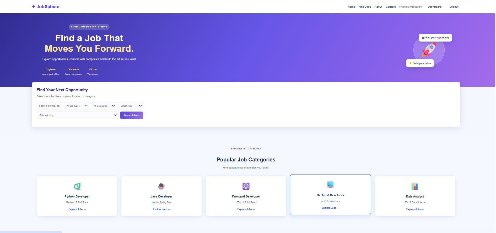
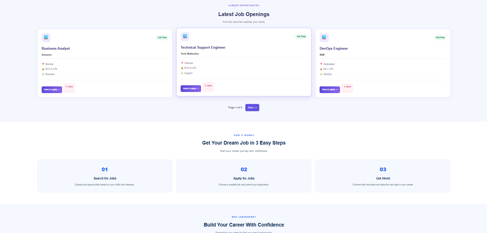
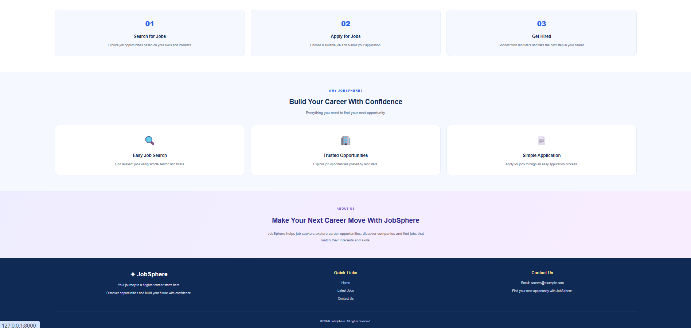

# JobSphere – Django Job Portal

## Project Overview
JobSphere is a web-based job portal developed using Python and Django. It helps candidates find job opportunities and allows recruiters to manage job applications.

## Technologies Used
- Python
- Django
- HTML5
- CSS3
- JavaScript
- SQLite
- Bootstrap

## Features
- User Registration and Login
- Candidate Dashboard
- Recruiter Dashboard
- View Latest Jobs
- Job Details Page
- Apply for Jobs
- Application Success Page
- Manage Job Applications

## Project Structure
- `config/` – Django project configuration
- `jobs/` – Main application
- `company_logos/` – Company logo images
- `manage.py` – Django management file

## How to Run the Project

1. Clone the repository:
   ```bash
   git clone https://github.com/maheswari-code-ctrl/JobSphere.git
   ```

2. Open the project folder:
   ```bash
   cd JobSphere
   ```

3. Create and activate a virtual environment:
   ```bash
   python -m venv venv
   venv\Scripts\activate
   ```

4. Install Django:
   ```bash
   pip install django
   ```

5. Apply migrations:
   ```bash
   python manage.py migrate
   ```

6. Run the development server:
   ```bash
   python manage.py runserver
   ```

7. Open `http://127.0.0.1:8000/` in your browser.

## Author
Maheswari

## Project Status
Learning and development project.


## Screenshots

### JobSphere Homepage


### Homepage Part 2


### Homepage Part 3



